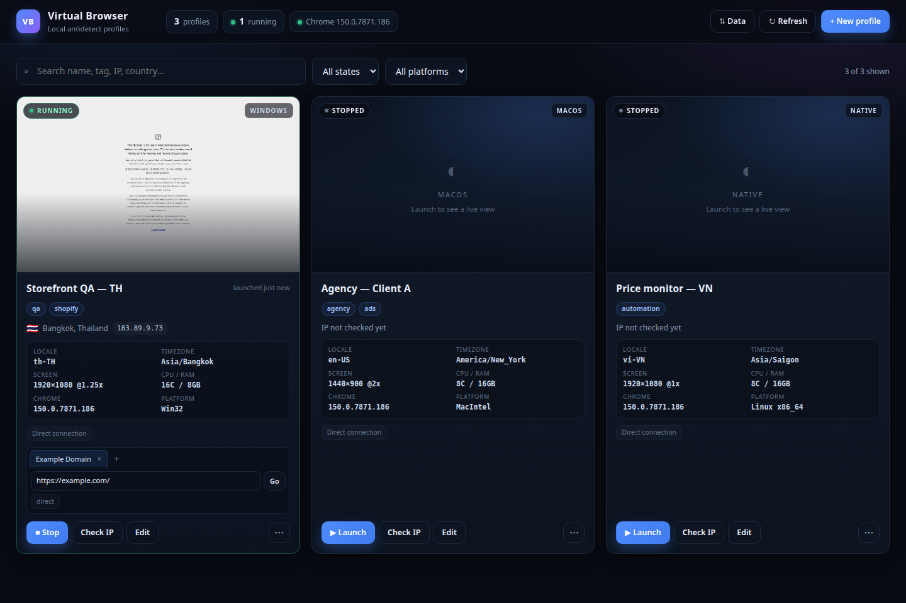

# Virtual Browser

[](LICENSE)
[](https://nodejs.org/)
[](https://www.google.com/chrome/)
[](docs/ROADMAP.md)

**Self-hosted, local-first Chrome profile manager for QA, geo testing, and browser
automation.** Each profile is an isolated identity with its own proxy/VPN, its own
`user-data-dir`, and a coherent fingerprint.

> **Status:** `v0.3.0` — beta, designed for a personal machine and bound to `127.0.0.1`.
> Not intended to be exposed to the Internet. Read [SECURITY](docs/SECURITY.md) before
> changing `VB_HOST`.



_Dashboard: live CDP screencast, tab/URL bar, fingerprint facts, and the profile's exit IP._

---

## Table of contents

- [Why this exists](#why-this-exists)
- [Who it is for](#who-it-is-for)
- [Features](#features)
- [Virtual Browser vs. cloud browser services](#virtual-browser-vs-cloud-browser-services)
- [Requirements](#requirements)
- [Quick start](#quick-start)
- [How it works](#how-it-works)
- [Configuration](#configuration)
- [Data and security](#data-and-security)
- [Architecture](#architecture)
- [API](#api)
- [Verification](#verification)
- [Known limitations](#known-limitations)
- [Acceptable use](#acceptable-use)
- [FAQ](#faq)
- [Contributing](#contributing)
- [License](#license)

---

## Why this exists

Working with multiple accounts, regions, or test cases usually breaks in the same three
places: **profiles leak data into each other, the exit IP does not match the identity, and
the fingerprint is internally inconsistent** — a Windows UA with a Vietnamese timezone, a
Mac GPU string, or the wrong locale.

Virtual Browser separates every identity into its own Chrome profile:

- a dedicated `user-data-dir` (cookies, localStorage, and cache never mix);
- a dedicated proxy or WireGuard tunnel, with optional credentials;
- a **deterministic fingerprint** generated from the profile seed and synced with the
  actual exit IP;
- a dashboard and REST API instead of a pile of one-off scripts.

Unlike cloud browser services, **the browser, the session, and the data stay on your
machine**. Sessions are persistent, you choose the network path, and there is no per-seat
subscription. It is also a self-hosted alternative to commercial anti-detect browsers: you
control the fingerprint, the network path, and the data.

## Who it is for

- **QA and test engineers** verifying pricing, language, layout, and checkout flows by
  country without maintaining a VM fleet.
- **Automation developers** who need clean, persistent browser profiles behind a local REST
  API, each with its own proxy.
- **Agencies and operators** managing multiple client accounts they own or are authorized
  to access, with strict session separation.
- **Privacy and security researchers** comparing fingerprints and checking for IP/WebRTC
  leaks.
- **Developers** who want a self-hosted alternative to commercial profile managers and do
  not want browsing data in someone else's cloud.

## Features

| Area | What you get |
| --- | --- |
| **Profiles** | create/edit/delete/duplicate, tags, notes, start URL, isolated `user-data-dir` |
| **Data safety** | JSON profile import/export, full `.tar.gz` backup/restore, path/size validation, additive restores (never overwrite) |
| **Network** | HTTP/HTTPS/SOCKS5 proxies **with auth**, WireGuard via `wireproxy`, or direct |
| **Local relay** | credential-free proxy endpoint for Chrome; handles CONNECT and absolute-form HTTP |
| **Fingerprint** | real Chrome UA + client hints, platform, locale, timezone, screen, DPR, WebGL, `hardwareConcurrency`, `deviceMemory`, color scheme, plugins, `navigator.webdriver` |
| **Geo sync** | exit-IP lookup through the profile's real path → locale/timezone, country/city/ISP |
| **Pinning** | manually pin locale/timezone so geo sync cannot override them |
| **Runtime** | launch/stop, live thumbnail via CDP screencast, tab list, open/close/switch tabs, URL bar |
| **Checks** | standalone proxy/IP test plus per-profile exit-IP check |
| **API** | full REST JSON API; the same server serves the static UI |
| **Security** | optional `VB_TOKEN`, CSRF same-origin guard, Host/DNS-rebinding guard, security headers |

**Not included:** cloud browsers, a cross-browser/device matrix (Safari, iOS, Android), or a
malware sandbox. See [Known limitations](#known-limitations).

## Virtual Browser vs. cloud browser services

Cloud testing services run disposable browsers on vendor infrastructure. Virtual Browser
runs persistent, customizable profiles on your machine. They solve different problems.

| | Virtual Browser | Cloud browser services |
| --- | --- | --- |
| Browser execution | Your machine | Vendor VMs |
| Session lifetime | Persistent (cookies, logins kept) | Usually disposable |
| Fingerprint control | Deterministic, customizable, geo-synced | Real browser/VM, not customizable |
| Network | Bring your own proxy/VPN | Vendor IP pools (often paid add-ons) |
| Data ownership | Stays local | Leaves your machine |
| Cost | Self-hosted, unlimited profiles | Per-seat subscription |
| Automation | Local REST API (CDP internally) | Vendor API/streaming |
| Environment coverage | Chrome on the host OS | Broad OS/browser/device matrix |
| Malware isolation | Not a sandbox | Disposable VM sandbox |

Use cloud services for "does this render on Safari iOS 18?" Use Virtual Browser for "operate
as this identity, from this region, with these cookies, for weeks."

## Requirements

- **Node.js ≥ 20** (22 LTS recommended).
- **Google Chrome / Chromium** installed on the host. The project drives real Chrome
  through `playwright-core`; it does **not** download bundled Chromium, so UA, client hints,
  codecs, and TLS behavior match the installed browser.
- Optional: **wireproxy** for WireGuard — <https://github.com/pufferffish/wireproxy>
- Linux headed mode needs X11/Wayland. Headless servers/CI can use `VB_HEADLESS=1`.

Quick check:

```bash
node -v          # >= 20
google-chrome --version
```

## Quick start

```bash
git clone https://github.com/dinhvanit/virtual-browser.git
cd virtual-browser
npm ci
npm start
```

Open **http://127.0.0.1:8787**.

Development mode (server restarts on change):

```bash
npm run dev
```

Try it with an isolated data directory and no display:

```bash
VB_HEADLESS=1 VB_PORT=8799 VB_DATA_DIR=/tmp/vb-dev npm start
```

Run with an API token:

```bash
VB_TOKEN=my-secret npm start
# open: http://127.0.0.1:8787/?token=my-secret
```

The token is stored in `localStorage` and removed from the URL after the first load.

Stop the server with `Ctrl+C`; child Chrome, relay, and VPN processes are closed.

## How it works

1. **Create a profile** — name, OS profile (`native`, `windows`, `macos`), start URL,
   tags/notes.
2. **Choose an identity** — leave locale/timezone empty to let geo sync fill them, or set
   them to pin.
3. **Attach a network** — HTTP/HTTPS/SOCKS5 proxy (with auth) or a WireGuard config, or
   direct. If both are configured, **VPN wins** and the proxy is not chained.
4. **Save → Launch** — Chrome starts with the profile's own `user-data-dir`, fingerprint,
   and network path.
5. **Work** — watch the live view, open/close/switch tabs, type a URL in the address bar.
6. **Check IP** — confirm the profile's real exit IP and geo.
7. **Stop** — Chrome, relay, and VPN are released; browsing data remains for the next run.

> Runtime sessions live in RAM only. Restarting the server shows profiles as **Stopped**,
> but cookies and logins in `user-data/` are preserved.

## Configuration

Everything is configured through environment variables; no `.env` file is required.

| Variable | Default | Purpose |
| --- | --- | --- |
| `VB_HOST` | `127.0.0.1` | Bind address. Only use `0.0.0.0` with `VB_TOKEN` and a firewall. |
| `VB_PORT` | `8787` | HTTP port. |
| `VB_DATA_DIR` | `./data` | Stores `profiles.json`, user-data dirs, and VPN logs. |
| `VB_TOKEN` | empty | When set, every `/api/*` request needs the `x-vb-token` header. |
| `VB_HEADLESS` | `0` | `1` runs Chrome headless (testing/CI only). |
| `CHROME_PATH` | auto-detected | Path to Chrome/Chromium. |
| `VB_CHROME_VERSION` | auto-detected | Override the version used for UA/client hints. |
| `VB_WIREPROXY` | auto-detected | Path to the `wireproxy` binary. |
| `VB_START_URL` | `https://example.com/` | Default start URL for new profiles. |
| `VB_GEO_TIMEOUT_MS` | `9000` | Geo/IP lookup timeout. |
| `VB_VPN_BOOT_TIMEOUT_MS` | `10000` | Time to wait for wireproxy to open its SOCKS5 port. |
| `VB_LOG_LEVEL` | `info` | Fastify log level (`debug`, `warn`, `error`). |
| `VB_MAX_IMPORT_MB` | `16` | Maximum JSON import body size. |
| `VB_MAX_BACKUP_MB` | `2048` | Maximum compressed backup/restore size (also caps browser downloads). |
| `VB_MAX_BACKUP_ENTRIES` | `200000` | Maximum entries in a restore archive (zip-bomb guard). |

Example:

```bash
VB_PORT=9000 VB_DATA_DIR=~/vb-data VB_TOKEN=... npm start
```

## Data and security

```text
data/                          # VB_DATA_DIR
├── profiles.json              # profile metadata
└── profiles/
    └── <uuid>/
        └── user-data/         # Chrome user-data-dir (cookies, localStorage, cache)
```

> **Warning:** `profiles.json` stores **proxy passwords in plain text**. Protect the
> permissions of `data/` (`chmod 700`), never commit it, and never share the file.
>
> `data/` is already ignored by `.gitignore`. Deleting a profile in the UI deletes its
> `profiles/<uuid>/` directory.

Recommendations:

- Enable `VB_TOKEN` on shared machines or when other untrusted processes run locally.
- Keep `VB_HOST=127.0.0.1`; do not expose the server to a LAN or the Internet.
- Back up `profiles.json` + `profiles/` if needed, but treat the backup as a secret.
- Only use proxies, VPNs, and accounts you own or are authorized to access.

Threat model: [docs/SECURITY.md](docs/SECURITY.md).

### Backup and restore

Use **Data** in the dashboard:

- **Export profiles (.json)** — metadata only: names, tags, proxy/VPN settings,
  fingerprints. No cookies, local storage or cache.
- **Backup all data (.tar.gz)** — `profiles.json` plus every `user-data/` tree. Stop all
  profiles first; the API returns `409` otherwise. **WireGuard `.conf` files are not
  included** because they normally live outside `data/`; back them up separately.
- **Import / restore** — always **additive**. Every imported profile gets a new id and its
  own data directory; existing profiles are never overwritten. Fingerprints and the
  original seed are preserved so restored logins keep the same identity.
- Restore rejects absolute paths, `..` traversal, symlinks, unsafe hardlink targets, devices,
  unknown entries and archives beyond the configured limits.

The JSON export and the `.tar.gz` backup contain **plaintext proxy credentials**, and the
backup also contains cookies and logged-in sessions. Neither is encrypted. Store backups
on encrypted media, restrict permissions, and never commit them.

## Architecture

```text
Browser UI (public/)
      │ JSON over fetch
      ▼
Fastify API (src/server)  ── token auth, CSRF/Host guard, security headers
      │
      ├── store.ts ──────────────► data/profiles.json (atomic writes)
      │
      └── runtime.ts
             ├── fingerprint.ts ── UA/client hints/locale/timezone/WebGL/screen
             ├── relay.ts ────────► local HTTP proxy (no auth) ──► authenticated upstream
             ├── vpn.ts ──────────► wireproxy ──► local SOCKS5
             ├── geo.ts ──────────► ipwho.is / ipapi.co through the real egress path
             └── playwright-core ─► real Chrome (isolated user-data-dir)
```

Launch flow:

1. Prepare the network path (VPN > proxy > direct). Authenticated proxies go through the
   local relay so Chrome never receives credentials on its command line.
2. Look up geo through that same path and apply locale/timezone unless pinned.
3. Start Chrome with the profile's context options and fingerprint init script.
4. Apply a CDP UA override per tab for complete client hints.
5. Start the screencast for thumbnails and return a running status with tabs.

More detail: [ARCHITECTURE](docs/ARCHITECTURE.md), [NETWORK](docs/NETWORK.md),
[FINGERPRINT](docs/FINGERPRINT.md).

## API

Base URL: `http://127.0.0.1:8787`. If `VB_TOKEN` is set:

```bash
curl -H "x-vb-token: $VB_TOKEN" http://127.0.0.1:8787/api/profiles
```

| Method | Endpoint | Description |
| --- | --- | --- |
| GET | `/api/health` | Health check |
| GET | `/api/system` | Chrome/wireproxy/platform/data-dir info |
| GET | `/api/export` | Export all profile metadata |
| POST | `/api/import` | Import profiles from an export (new ids) |
| GET | `/api/backup` | Download a full `.tar.gz` backup |
| POST | `/api/restore` | Restore a `.tar.gz` backup (additive) |
| GET | `/api/profiles` | List profiles with runtime status |
| POST | `/api/profiles` | Create a profile |
| GET/PATCH/DELETE | `/api/profiles/:id` | Read/update/delete a profile |
| POST | `/api/profiles/:id/duplicate` | Duplicate a profile |
| GET/POST | `/api/profiles/:id/fingerprint` | Read/regenerate the fingerprint |
| POST | `/api/profiles/:id/check` | Check the profile's exit IP |
| POST | `/api/proxy/check` | Test a proxy independently |
| POST | `/api/profiles/:id/launch` | Launch Chrome |
| POST | `/api/profiles/:id/stop` | Stop Chrome |
| GET | `/api/profiles/:id/session` | Status, tabs, streaming state |
| GET | `/api/profiles/:id/thumbnail` | JPEG live-view frame |
| POST | `/api/profiles/:id/navigate` | Navigate the active tab |
| POST | `/api/profiles/:id/tabs` | Open a tab |
| POST | `/api/profiles/:id/tabs/:index/activate` | Activate a tab |
| DELETE | `/api/profiles/:id/tabs/:index` | Close a tab |

Responses are shaped as `{ profile }`, `{ profiles }`, `{ status }`, etc. Full reference:
[docs/API.md](docs/API.md).

## Verification

```bash
npm run verify             # typecheck + proxy stack + fingerprint
npm run verify:proxy       # HTTP/SOCKS5 auth + relay (no Chrome needed)
npm run verify:fingerprint # launches Chrome and compares generated vs. observed values
npm run verify:ui http://127.0.0.1:8787   # CRUD smoke test (server must be running)
npm run verify:data http://127.0.0.1:8787 # export/import + backup/restore (server running)
npm run verify:ui-data http://127.0.0.1:8787 # dashboard Data menu (server + Chrome)
npm run verify:token                      # missing/invalid token messages (server with VB_TOKEN)
npm run ui:shot http://127.0.0.1:8787 /tmp/vb.png
```

`verify:ui`, `verify:data`, `verify:ui-data` and `verify:token` require a running server;
`verify:token` requires `VB_TOKEN`. Use a throwaway `VB_DATA_DIR` for the data tests.

## Known limitations

- **Chrome only**, on the host OS. No Safari, iOS, Android, IE, or cross-browser/OS matrix.
- **Not a malware sandbox.** Profiles isolate browser data, but share the host OS. Do not
  open hostile links or files on your real machine.
- Fingerprint spoofing does not yet fully cover canvas/audio/fonts/geolocation/media
  devices; `navigator.plugins` is a stub, not a real `PluginArray`.
- No team/RBAC/SSO or multi-machine sync yet.
- Runtime sessions do not survive a server restart (browsing data does).
- Backups require all profiles to be stopped and are **not encrypted**. JSON exports do
  not include cookies; use a full backup for browser data.
- A large backup is buffered by the browser when downloading; very large profiles may be
  better copied with `tar` on the server.
- `wireproxy` must be installed separately; no binary is bundled.
- No unit tests/CI yet; the verify scripts are end-to-end smoke tests.

## Acceptable use

**Good fit:**

- QA/testing of country, language, timezone, and IP-dependent behavior.
- REST-driven automation with clean, persistent, proxied profiles.
- Managing multiple accounts **you own or are authorized by a client to operate**.
- Privacy research: fingerprint comparison, IP/WebRTC leak checks.
- Agencies managing client accounts with the client's consent.

**Not allowed / not a good fit:**

- Fake accounts, account farming, ban evasion, ad fraud, or spam.
- Violating platform terms or applicable law.
- Opening malicious links/files on a real machine (use a dedicated sandbox/VM).
- Real cross-browser/device testing (use Browserling, Sauce Labs, BrowserStack, etc.).

The project ships no proxies, VPNs, accounts, or third-party data. You are responsible for
how you use it and for complying with the law and platform terms.

## FAQ

**Is this an anti-detect browser?**
It is a profile and fingerprint manager. It keeps each profile internally consistent (UA,
locale, timezone, screen, WebGL, exit IP) and isolates sessions. No tool can guarantee
evasion; real detection also uses behavior, TLS, and account history.

**Does it include proxies or VPNs?**
No. Bring your own HTTP/HTTPS/SOCKS5 proxy or WireGuard config. Traffic never passes through
a server operated by this project.

**Which operating systems are supported?**
Linux, macOS, and Windows. You need Node.js 20+ and Chrome. Headless works for CI, but
produces a weaker fingerprint; headed mode is recommended for real work.

**Can I connect Playwright or Puppeteer to a running profile?**
Not through an external CDP endpoint today. Automation goes through the REST API (launch,
stop, navigate, tabs, thumbnail). Exposing a CDP endpoint is on the [roadmap](docs/ROADMAP.md).

**Is it free?**
Yes, under AGPL-3.0. Commercial/dual licensing is available — see [License](#license).

**Can I use it for scraping or multiple accounts?**
Only in compliance with the target site's terms and applicable law, and only for accounts you
own or are authorized to operate. Fraud, ban evasion, and account farming are not supported.

**Does it work on a server or in Docker?**
It runs, but realistic fingerprints need a display; headless is for testing/CI. Docker
packaging is on the roadmap.

---

## Contributing

```bash
npm install
npm run dev
npm run verify
```

- Keep code, APIs, and identifiers in English; user-facing text and docs are English.
- Add a verification case when changing networking or fingerprint behavior.
- Never commit `data/`, cookies, proxy credentials, logs, or binaries.
- Open an issue before large changes.

Workflow: [docs/PROCESS.md](docs/PROCESS.md).

## License

Copyright © 2026 **dinhvanit**.

Released under the **GNU Affero General Public License v3.0** (`AGPL-3.0-only`) — see
[LICENSE](LICENSE) and [NOTICE](NOTICE).

AGPL requires that if you modify the source and offer it as a network service, you must
make the modified source available. For commercial or dual licensing, open an issue at
<https://github.com/dinhvanit/virtual-browser/issues>.

## Disclaimer

Provided **"as is"**, without warranty. The author is not liable for damages, data loss,
terms-of-service violations, or legal consequences arising from use. Check the law and the
terms of any platform you use.
